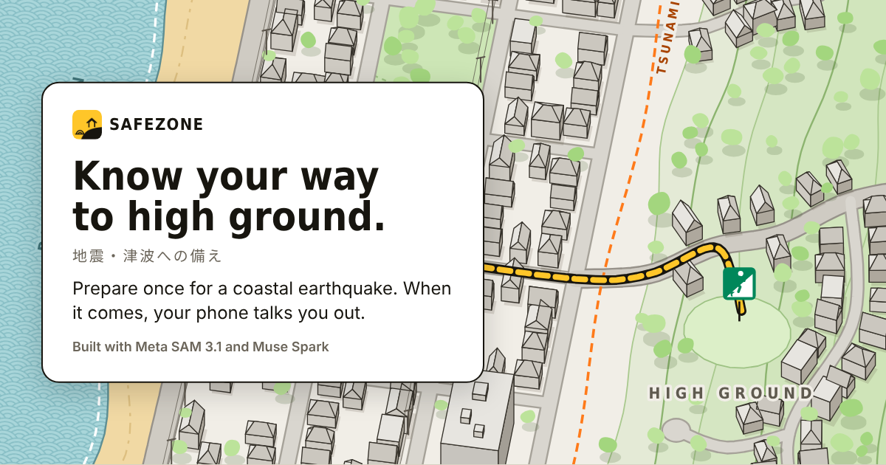
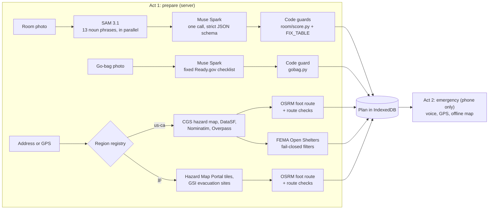

<!--
TODO: put your name in the Credits line.
TODO after tomorrow's recording:
- Go-bag check: if `python tools/record_fixtures.py --gobag <photo>` succeeds, change "The demo's go-bag result is SAMPLE data" in "How it works" and "Honest limits" to say it is a recorded Muse Spark answer.
- Kamakura: if `python tools/record_japan.py` succeeds and demo/plan_jp.json is rebuilt from it, change "Kamakura is SAMPLE data" in "Regions" and "Honest limits" to "recorded real data".
-->

# SafeZone

Prepare once for a coastal earthquake. When it comes, the phone talks you through it.



**Live app:** https://safezone-alpha-one.vercel.app/ · **Repo:** https://github.com/judecutler/safezone

Built for the Meta Global AI Developer Hackathon (indie track, Build for Your World). Everything here was written during the hackathon, and the git history shows each step.

## The problem

On Dec 5, 2024, a magnitude 7.0 earthquake off Cape Mendocino put about 5 million people under a tsunami warning for 70 minutes ([KQED](https://www.kqed.org/news/12032295); timeline in the [Berkeley after-action report](https://dev.berkeleyca.gov/sites/default/files/documents/2025-04-18%20%202024%20Tsunami%20Warning%20-%20After%20Action%20Report%20and%20Community%20Survey%20Summary.pdf), pp. 9 to 12). Berkeley's survey of 1,602 residents found that people did not know where the inundation zone was, some evacuated from outside it, and the phone alert carried no zone details (same report, pp. 15 to 23). Preparation works when it happens before the day. In Kamaishi in 2011, after years of school drills, nearly all of the city's roughly 3,000 schoolchildren reached high ground ([Government of Japan](https://www.atlanta.us.emb-japan.go.jp/hts5.html)). Shaking itself hurts people through their furniture: in Japanese earthquakes since 2003, 30% to 50% of injuries came from furniture tipping, falling or sliding ([Tokyo Fire Department](https://www.tfd.metro.tokyo.lg.jp/content/000010472.pdf)). Yet only 35% of Californian adults say they are prepared for a disaster ([PPIC, 2024](https://www.ppic.org/blog/few-californians-are-prepared-for-a-disaster/)), and in Japan 34.5% have chosen an evacuation site and route ([Cabinet Office poll, 2022](https://survey.gov-online.go.jp/r04/r04-bousai/gairyaku.pdf)).

## What SafeZone does

SafeZone is a household plan in two acts.

**Act 1. Prepare once.** You walk through a short, camera-first setup.

1. Photograph each room. SAM 3.1 finds the furniture and objects that matter, Muse Spark reasons about how they relate, and code picks the best place to take cover and a fix list.
2. Photograph the way out, your open go bag and the gas shutoff. Muse Spark checks the go bag against Ready.gov's basic kit.
3. Give the address, or let the phone locate you. SafeZone checks the official tsunami hazard map, finds a walking route out of the hazard area that passes its own checks, and lists shelters that fit your household (children, wheelchair, medical needs, pets).
4. Save the place. The plan is stored on the phone and prints as a two-page fridge sheet. You can save several places, such as home and work.

**Act 2. In an emergency, the phone talks you through it.** While the places screen is open, SafeZone listens for sustained strong shaking with the motion sensor. You can also tap **Emergency**.

1. During shaking, the screen and the voice say one thing: Drop, Cover, Hold On, with the saved spot for your room. Nothing tells you to move.
2. When you tap **Shaking has stopped**, and the place is in the hazard area, the voice says to go now, on foot. Then it gives turn-by-turn directions along the saved route from live GPS. The route map is drawn from stored data, without map tiles, so it works with no signal.
3. **Shelters that fit your household** lists filtered, ranked shelters (in California) or designated evacuation sites (in Japan).

## Try it in 60 seconds

Turn your sound on. The emergency part is spoken. A phone works best, and a desktop browser in a narrow window also works.

1. Open https://safezone-alpha-one.vercel.app/ and tap **Run the demo**. The demo asks for no permissions and uses recorded data. Every demo screen carries a DEMO banner.
2. Tap **Continue**. On each photo step, tap the shutter (it uses the recorded demo photo) or **Skip**, then **Finish**.
3. On the review screen, look at the room result. "What Muse Spark noticed" shows the model's reasoning. The "Drop here" card shows that SafeZone's own checks set aside the model's proposed floor spot because it was in a doorway. Tap **Save this place**.
4. On **My places** you see two demo places: Ocean Beach, San Francisco, and Kamakura, Japan. Tap **Simulate an earthquake**.
5. Listen. The phone says "This is a demo", then "Drop, cover and hold on" with the room's spot, and repeats it every 15 seconds. Tap **Shaking has stopped**.
6. Listen to the go-now line, then watch the demo walker move along the 10-minute route with spoken turns. **Walker speed 8x** speeds it up.
7. Tap **Shelters that fit your household**. These cards are tagged SAMPLE DATA because FEMA listed no open shelters on the day we recorded.
8. Back on the landing page, **How it works** shows the Meta model pipeline with the demo room's recorded SAM 3.1 and Muse Spark output.

To try it on your own home, tap **Map my home** instead. A real room scan on the live site takes about 50 seconds and runs in the background while you take the other photos.

## How it works



The server is a small Starlette app (`safezone/app.py`). The web app is vanilla JavaScript with no build step (`web/`). Every outside call goes through one boundary, `safezone/transport.py`, which can run live, record responses or replay them. Every value carries its provenance (`live`, `recorded` or `sample`), and the app labels sample data.

### Where the Meta models are used

There are two Meta models, called through the Meta Model API (`safezone/meta.py`).

- **SAM 3.1** (`sam-3.1`) segments each room photo. SafeZone sends 13 noun phrases ("table", "desk", "bookshelf", "cabinet", "wardrobe", "window", "glass door", "mirror", "ceiling light", "TV", "bed", "box", "door") as 13 parallel streaming requests to `POST /responses` (`safezone/room/segment.py`). Masks are decoded with `meta-sam-parser`. If a mask does not decode, SafeZone falls back to the box.
- **Muse Spark** (`muse-spark-1.3` by default) is called on `POST /chat/completions` with a strict `json_schema` and `reasoning_effort: low`. SafeZone makes two kinds of call.
  - Room reasoning (`safezone/room/classify.py`). The model gets the photo and SAM's segment list. It returns a role and hazard kind for each segment, spatial relations (in the tip zone, under stored items, near glass, blocks the exit), a proposed open-floor spot and a note about the way out.
  - Go-bag check (`safezone/gobag.py`). The model gets the photo and the 14 item ids from Ready.gov's basic kit. It returns, per id, whether the item is visible and a short note.

### What code decides, not the model

- **Room.** Code drops any answer that names an unknown segment. `room/score.py` rejects the model's floor spot if it is outside the photo, in a doorway, on or inside furniture, above the floor line, in a tall object's tip zone, below stored items, or close to glass. These checks go by what the object is, so a model that calls a wardrobe "neutral" cannot switch them off. Cover counts only for a table or desk away from glass. If no spot passes, the plan gives the fixed "no table nearby" guidance. The model picks a hazard kind. The fix text comes only from `FIX_TABLE` in `safezone/rules.py`.
- **Go bag.** Code keeps the checklist's own ids, labels and order and drops any other id. It removes notes that use words such as "complete", "enough" or "ready". The result says "Seen in the photo" or "Not seen", and it never says the kit is complete. The demo's go-bag result is SAMPLE data.
- **Route (California).** `safezone/route/pipeline.py` sends OSRM foot routes to candidate points on the CGS map's own "outside the hazard area" land polygons. It samples each route every 50 m and rejects it if the route does not end on that land, goes deeper into the zone than home, doubles back, re-enters the zone, or wanders along the shore. If no route passes, the plan gives a compass direction toward proven land. If there is none, it says "SafeZone could not check a route" and gives the official fallback. Walking time uses 1.0 m/s, a pace chosen for children and older adults.
- **Shelters (California).** `safezone/shelter/pipeline.py` reads FEMA's Open Shelters layer. It drops shelters that are not open, that are inside the hazard area, or whose hazard check failed. For a wheelchair household it keeps only shelters listed as wheelchair accessible. It counts every exclusion and ranks the rest by walking time, with shelters at 80% of capacity or more ranked after the others.

### Regions

`safezone/regions.py` holds one entry per covered area, and each entry owns geocoding, the building profile, the evacuation plan and the guidance text. A place outside every region gets "SafeZone has no hazard data for this area yet". SafeZone never guesses. `docs/regions.md` explains how to add a region.

- **California (`us-ca`), the main demo.** 1000 Great Highway, San Francisco, which is inside the official CGS tsunami hazard area. The room, building and route data are real responses recorded on Nov 3. The shelters are SAMPLE data.
- **Japan (`jp`).** Kamakura City Hall. Tokyo's 23 wards have no mapped tsunami inundation, because Tokyo's assumption covers only its islands, so the demo uses Kamakura. SafeZone reads the Hazard Map Portal inundation tiles and depth classes, routes to designated tsunami evacuation sites from GSI, and checks each route against the inundation raster (`safezone/japan/evac.py`). Japanese guidance is quoted verbatim from the Cabinet Office and JMA in `safezone/japan/rules.py`, with an English rendering that the app shows and speaks. Kamakura is SAMPLE data until it is recorded with `tools/record_japan.py`.

## Safety design

These rules are enforced in code and tests (`tests/test_adversarial_safety.py` and others).

- **Nobody is told to move during shaking.** The shaking screen's only step forward is **Shaking has stopped**, and it ignores taps for the first 3 seconds. A **Leave emergency mode** link returns to your places. A false alarm from the motion sensor only opens this screen, which asks nothing risky.
- **No structural claims from a photo.** SafeZone never says "safe route", "guarantees" or "structural". It names the best place to take cover, not a safe place.
- **Model output becomes an instruction only through a code guard.** Fixes come only from `FIX_TABLE`. The instruction read during shaking is fixed text. The model's own words appear only as labelled context ("What Muse Spark noticed").
- **Sample, replay and demo data are always labelled.** Cards carry SAMPLE DATA and REPLAY DATA tags, and demo screens carry a DEMO banner.
- **Failures fail closed.** An unknown hazard status removes a shelter. A route without proof of land is not shown. A missing hazard map produces "follow official instructions, move inland and uphill", never a quiet "outside".

The voice follows the same rules (`web/js/voice.js`, `web/js/guide.js`, `web/js/screens/emergency.js`).

- It speaks only three kinds of text: the official guidance from `rules.py` verbatim, the saved spot instruction from the fixed table, and route steps joined by fixed connectives.
- During shaking it repeats only "Drop, cover and hold on" and the spot instruction, every 15 seconds.
- In demo mode it starts with "This is a demo."
- A **Voice on** toggle mutes it on every emergency screen, and the screen stays awake (Wake Lock API).
- Cues never repeat themselves. Off the route, it says to head back toward the route. Far from the route, it says to walk inland and uphill and follow evacuation signs.

## Data sources

Meta models: [SAM 3.1](https://dev.meta.ai/docs/sam/segmenting) and Muse Spark ([models](https://dev.meta.ai/docs/models)), through the Meta Model API.

California:

- California Geological Survey, [Tsunami Hazard Area layer](https://gis.conservation.ca.gov/server/rest/services/CGS/IW_Tsunami_Hazard_Area/FeatureServer/0) and [tsunami maps](https://www.conservation.ca.gov/cgs/tsunami/maps).
- DataSF, [Soft-Story Properties](https://data.sfgov.org/d/beah-shgi) (`beah-shgi`, San Francisco only).
- FEMA, [Open Shelters layer](https://gis.fema.gov/arcgis/rest/services/NSS/OpenShelters/FeatureServer/0).

Japan:

- Hazard Map Portal, [tsunami inundation tiles (open data)](https://disaportaldata.gsi.go.jp/hazardmap/copyright/opendata.html).
- GSI, [designated emergency evacuation sites](https://www.gsi.go.jp/bousaichiri/hinanbasho.html) (layer `skhb05`, tsunami).
- MLIT, [hazard map guide](https://www.mlit.go.jp/river/basic_info/jigyo_keikaku/saigai/tisiki/hazardmap/suigai_hazardmap_tebiki_201604.pdf) (depth colours, pp. 37 and 38).

Both regions:

- OpenStreetMap: [Nominatim](https://nominatim.org/) geocoding, [Overpass](https://overpass-api.de/) building data (with mirrors at overpass.private.coffee and overpass.kumi.systems), and [OSRM foot routing](https://routing.openstreetmap.de/).

Safety guidance, quoted in `safezone/rules.py` and `safezone/japan/rules.py`:

- [Ready.gov: Earthquakes](https://www.ready.gov/earthquakes) and [Ready.gov: Build a Kit](https://www.ready.gov/kit).
- [ShakeOut: Drop, Cover, Hold On](https://www.shakeout.org/dropcoverholdon/).
- [CGS: before, during and after a tsunami](https://conservation.ca.gov/cgs/tsunami/preparedness) and [CGS: How to survive a tsunami](https://www.conservation.ca.gov/cgs/Documents/Tsunami/How-to-Survive-a-Tsunami.pdf).
- [PG&E: Earthquake safety](https://www.pge.com/assets/pge/docs/newsroom/safety-action-center/earthquake.pdf).
- [Cabinet Office tsunami flyer](https://www.bousai.go.jp/kyoiku/poster/pdf/tsunami_flyer_nigetore.pdf), [JMA: protecting yourself from tsunamis](https://www.jma.go.jp/jma/kishou/know/jishin/tsunami_bosai/), [JMA Osaka memo 192](https://www.data.jma.go.jp/osaka/jishinkazan/hitokuchi/192_tsunamihinan_202105.pdf) and [JMA: acting on an Earthquake Early Warning](https://www.data.jma.go.jp/svd/eew/data/nc/koudou/kokoroe.pdf).

## Privacy

There are no accounts. The server stores nothing, and photos and addresses exist only for the length of a request (`safezone/app.py`). Plans and photos stay on the phone, in IndexedDB. The emergency screens read only IndexedDB and make no server calls.

## Run it locally

You need Python 3.12 or later. Demo mode needs no API key and no network. A real scan needs a Meta Model API key in `MODEL_API_KEY`.

Windows PowerShell:

```powershell
git clone https://github.com/judecutler/safezone
cd safezone
python -m pip install -r requirements.txt
Copy-Item .env.example .env   # then put your key after MODEL_API_KEY=
python -m uvicorn safezone.app:create_app --factory --port 8000
```

macOS or Linux:

```sh
git clone https://github.com/judecutler/safezone
cd safezone
python3 -m pip install -r requirements.txt
cp .env.example .env          # then put your key after MODEL_API_KEY=
python3 -m uvicorn safezone.app:create_app --factory --port 8000
```

Open http://localhost:8000. To answer every outside call from the recorded responses instead of the network, set `SAFEZONE_FIXTURES=fixtures/demo` before you start the server (`$env:SAFEZONE_FIXTURES="fixtures/demo"` in PowerShell).

To record fresh responses on your own machine, run `python tools/record_fixtures.py` (room, building, route and shelters), `python tools/record_fixtures.py --gobag <photo>` (a go-bag check) and `python tools/record_japan.py` (Kamakura, no key needed). If a recording fails with `CERTIFICATE_VERIFY_FAILED`, run `python -m pip install --upgrade certifi` and try again.

`index.py` and `vercel.json` deploy the same app to Vercel. `modal_app.py` deploys it to Modal.

## Tests

- `python -m pytest -q` runs 234 Python tests, including adversarial safety tests, record-then-replay tests and a test of the whole demo plan.
- `node --test web/tests/*.test.mjs` runs 36 tests of the photo-quality meter, the turn-by-turn guide (including GPS noise and walking the route backward) and the app logic.
- `node tools/verify_e2e.cjs <outdir> <base-url>` (needs Playwright and a running server) makes 132 checks in a phone-sized Chromium: the demo end to end with the spoken voice log, the real flow, offline, a phone with no saved places, and plans saved by the old app.

## Honest limits

- A web app cannot wake itself. Standby listens for shaking only while the places screen is open on a phone that is awake. It does not receive official alerts.
- The demo shelters are SAMPLE data, because FEMA's Open Shelters layer listed 0 open shelters on the quiet day we recorded. The filters and ranking are real and tested.
- The demo's go-bag result is SAMPLE data, and Kamakura is SAMPLE data until it is recorded.
- SafeZone is not a structural assessment. It shows hazards it can see in a photo and flags from official public data. It does not have your building's plans.
- Routes are planning aids, not official evacuation routes. Official instructions, municipal hazard maps and local evacuation signs always come first.
- The hazard map is the minimum, not the limit. At Unosumai in Kamaishi in 2011, 86% of the dead were in homes outside the mapped hazard area ([EERI report](https://kamome.humboldt.edu/sites/default/files/Japan-eq-report-tsunami_dengler.pdf)). SafeZone's guidance tells people at the end of the route to keep moving inland and uphill if they can.
- The CGS map is a worst-case scenario. SafeZone calls it "the official tsunami hazard area", not "where the wave will go".

## Roadmap

- Real alerts, such as USGS ShakeAlert in California and J-Alert in Japan, to start the emergency screens.
- More regions. Each region is one adapter set and one registry entry (`docs/regions.md`).
- Floor plans pinned to room scans.
- Room scans through Meta's glasses.

## Credits

Built by [your name here] with Claude Code. Meta's SAM 3.1 and Muse Spark do the vision work. Hazard data comes from the California Geological Survey, DataSF, FEMA, Japan's Hazard Map Portal, GSI and MLIT. Maps and routing come from OpenStreetMap contributors, Nominatim, Overpass and the FOSSGIS OSRM service. Guidance comes from Ready.gov, the Earthquake Country Alliance (ShakeOut), CGS, PG&E, Japan's Cabinet Office and JMA. Background facts and their sources are in `docs/story.md`.
